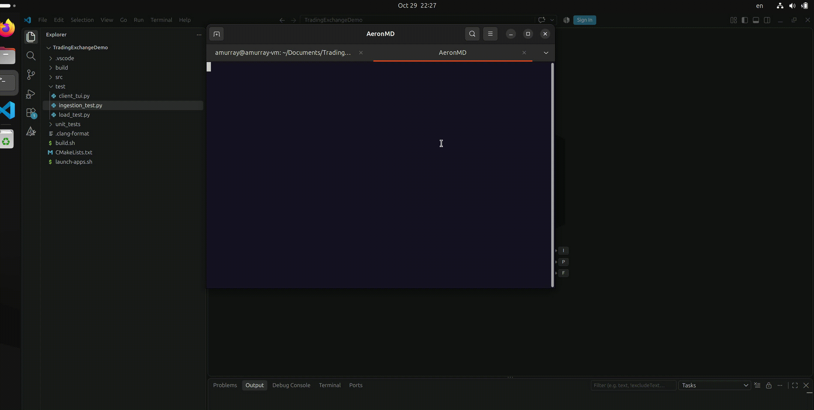

# Trading Engine

A demo trading engine... this project implements a FIX gateway + matching engine aiming to demonstrate the essential user-mode parts of a trading system with the usual low-latency practices of zero-allocation parsing, contiguous memory structures, and lock-free IPC.

## 🚀 Overview

The TCP gateway and the matching engine run as separate processes (can be pinned to separate cores). They communicate via Aeron shared memory ring buffers. Incoming FIX messages are validated and translated into 64-byte aligned Simple Binary Encoding (SBE) structs without a single heap allocation. The limit order book utilizes `boost::container::flat_map` backed by `boost::container::static_vector`. Networking is handled via a single-threaded `epoll` loop.

  

## 📊 Components

1.  **Gateway:** Manages TCP connections and FIX session state (Logon, SeqNum tracking), parses text to SBE, and publishes to the inbound Aeron stream.
    
2.  **Matching Engine:** Subscribes to the inbound Aeron stream, executes price-time priority matching, and publishes execution reports (fills/partial fills) and market data updates.
    
3.  **Market Viewer:** A downstream process that subscribes to the matching engine Aeron stream, displaying a live order book in the terminal.
    

## 📊 Demo-yy stuff

Some things that I didn't do...

-   **Kernel Bypass:** Replace `epoll` with some kernel bypass method e.g., eBPF XDP.
    
-   **Aeron `tryClaim`:** Currently, SBE structs are built on the stack and `memcpy`'d into Aeron via `.offer()`. I only discovered `.tryClaim()` at the end; switching would allow the gateway to write directly into Aeron's shared memory, achieving proper zero-copy IPC.
    
-   **Integer Parsing:** Replace standard floating-point price parsing with a custom fixed-point integer string parser to avoid rounding error.
    
-   **Logging:**  `std::cout` was used for testing; use a lock-free ring buffer picked up by a process pinned to a different core.
    
-   **Architecture:** IPC is a bit spaghetti, with too many callbacks making the code less aesthetic. The gateway sends to the trading engine, which sends matched orders back to the gateway, which in turn sends the response back to the client as that holds the session information. Ideally, the response to buyers/sellers would be downstream and that code would be shared. Market viewer was an afterthought which receives changes from the trading engine.
    

## 🤖 The Role of AI Here

As with all these learning projects, there is no agentic AI whatsoever. There was minimal use of sandboxed Gemini where it guided the architecture/components. Its most invaluable attribute here is for domain knowledge. AI was used entirely to generate Python tests, as if it's not C++ or Rust, there is zero inclination to dedicate time during learning tasks.